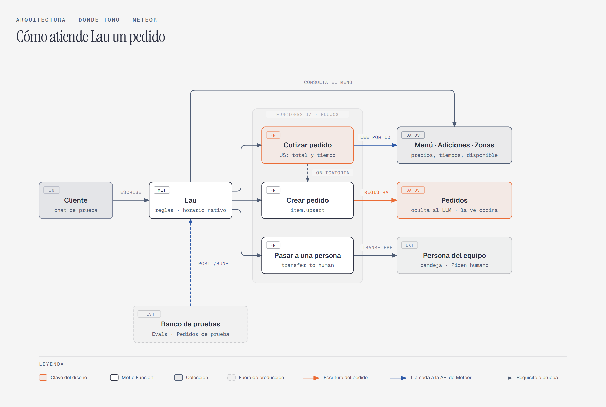

# Donde Toño: agente de pedidos en Meteor

Reto de ingreso para Implementador de Agentes IA en Meteor (fase 2, octubre de 2026). Es un agente de WhatsApp, "Lau", que toma pedidos para un restaurante de comida rápida en Laureles, Medellín. Responde qué hay y cuánto vale, suma bien las adiciones, dice en cuánto llega, no vende lo que no hay y deja el pedido completo para cocina.

**Empieza por aquí:** [`07-entregables/documento-donde-tono.pdf`](07-entregables/documento-donde-tono.pdf). En 2 páginas trae los supuestos, las preguntas al cliente, lo que quedó por fuera, lo que puede fallar y cómo se probó.

## Cómo está armado

- **Lau** (un Met de Meteor) conversa y entiende el pedido, pero no suma.
- **`cotizar_pedido`** es una Función IA respaldada por un flujo. Lee el Menú, las Adiciones y las Zonas, y calcula el total y el tiempo en JavaScript, de forma determinista. El código está en [`04-plataforma/cotizar_pedido_calcular.js`](04-plataforma/cotizar_pedido_calcular.js).
- **`crear_pedido`** registra el pedido en la colección Pedidos, que el modelo no ve. Solo funciona si se cotizó en el mismo turno.
- **`pasar_a_humano`** deja la conversación con una persona del equipo cuando hay una queja, un pedido grande o un barrio que no está en la lista.

## Qué hay en cada carpeta

- **`03-diseno/`**
  - [`spec-funcional.md`](03-diseno/spec-funcional.md): reglas de negocio, supuestos, guardrails, casos de uso y los 24 escenarios de aceptación.
  - [`construccion.md`](03-diseno/construccion.md): cómo se cumple cada parte del spec en Meteor.
  - [`lau-configuracion.md`](03-diseno/lau-configuracion.md): las instrucciones del agente, que es la fuente única.
- **`04-plataforma/`**
  - El código del cálculo.
  - `aplicar_lau.mjs`, que aplica la configuración del agente por API y verifica que quedó igual.
- **`05-datos/`**: la hoja del cliente ya limpia (menú, adiciones y zonas) y el script que la carga en Meteor.
- **`06-pruebas/`**
  - Los scripts de prueba:
    - el cálculo en local y dentro de Meteor;
    - la conversación por `POST /runs`;
    - la validación de los datos.
  - [`registro-pruebas.md`](06-pruebas/registro-pruebas.md): cada corrida con su resultado, sus fallas y sus arreglos.
  - `evidencia/`: las respuestas de la API y las capturas de las pruebas manuales.
- **`07-entregables/`**: el documento (PDF y su HTML), el diagrama y los CSV de los pedidos de prueba y de los evals.

## Cómo se probó, en corto

- **El cálculo:** 24 de 24 (12 pedidos con total conocido y 12 rechazos), en local y dentro de Meteor.
- **La conversación:** 24 escenarios.
  - 20 por API: checks automáticos más lectura de cada transcripción.
  - 4 a mano en el chat real.
- **Resultado:** 21 pasan, 3 pasan con observación y 1 limitación de la plataforma. Está explicado en el documento.

## Lo que no está aquí

- Las llaves de API: viven en un `.env` que no se sube.
- El enunciado del reto y el hilo de correos con Meteor.
- Las notas internas del panel y los respaldos de configuración.

Algunos documentos citan esos archivos. Las rutas se dejaron tal cual para no reescribir el historial de trabajo.

Los scripts necesitan un workspace de Meteor con las colecciones cargadas y un `.env` con las variables `MET_API_KEY`, `MET_API_KEY_FLOW` y `WORKSPACE_ID`.

## Uso de IA

El trabajo se hizo con Claude Code, que escribió la mayor parte del código y de los documentos. Las decisiones de alcance y de diseño, y las pruebas en el chat real, fueron de Jhon. El detalle está en la sección 07 del documento.

Jhon Escobar
